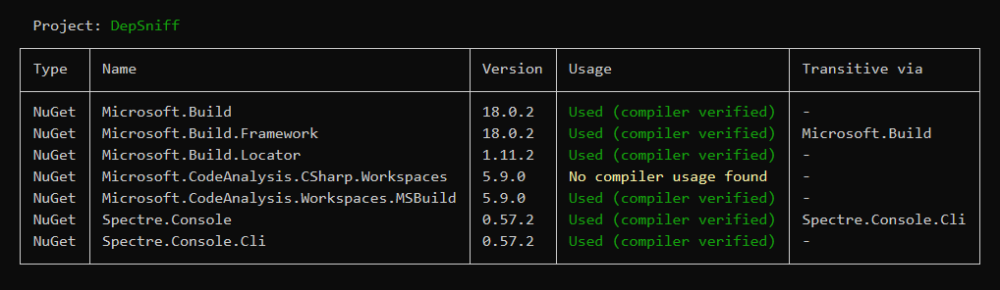

| Package | NuGet |
| :--- | :--- |
| Microsoft.Build | [](https://www.nuget.org/packages/Microsoft.Build/) |
| Microsoft.Build.Locator | [](https://www.nuget.org/packages/Microsoft.Build.Locator/) |
| Microsoft.CodeAnalysis.CSharp.Workspaces | [](https://www.nuget.org/packages/Microsoft.CodeAnalysis.CSharp.Workspaces/) |
| Microsoft.CodeAnalysis.Workspaces.MSBuild | [](https://www.nuget.org/packages/Microsoft.CodeAnalysis.Workspaces.MSBuild/) |
| Spectre.Console | [](https://www.nuget.org/packages/Spectre.Console/) |
| Spectre.Console.Cli | [](https://www.nuget.org/packages/Spectre.Console.Cli/) |

# DepSniff 🕵️‍♂️

**DepSniff** is a lightweight .NET CLI tool designed to help you clean up your C# projects by identifying redundant NuGet packages and project references. It "sniffs out" dependencies that are already provided transitively by other references or appear to be unused in your source code.

## Features

- 📂 **Supports Modern Solutions**: Works with both `.csproj` and the new Visual Studio solution format `.slnx`.
- 🔗 **Redundancy Detection**: Identifies NuGet packages and project references that are explicitly added but already inherited transitively.
- 🔍 **Usage Analysis**: Uses Roslyn and MSBuildWorkspace to identify assembly references used by the C# compiler, including aliases, attributes, extension methods and conditional compilation across target frameworks.
- 📊 **Clear Reporting**: Generates easy-to-read tables using [Spectre.Console](https://spectreconsole.net/) to show the status of each dependency.
- 🛠️ **Built on .NET 10**: Loads projects with the installed .NET SDK and analyzes their compilations without emitting application binaries.

## Prerequisites

- [.NET 10.0 SDK](https://dotnet.microsoft.com/download/dotnet/10.0).

MSBuild is loaded from the installed SDK at runtime.

## Installation

Currently, DepSniff can be run directly from the source.

```powershell
# Clone the repository
git clone https://github.com/Iceeman76/DepSniff.git
cd DepSniff

# Build the project
dotnet build
```

## Usage

Run DepSniff by pointing it to a solution or project file:

```powershell
dotnet run --project DepSniff -- <PATH_TO_PROJECT_OR_SOLUTION>
```

First run `dotnet restore <PATH_TO_PROJECT_OR_SOLUTION>` for the target being analyzed. DepSniff reads the restored `project.assets.json` files and warns if they are missing or unreadable. Referenced projects are followed even when they are not listed in the solution or the input is a single `.csproj`.

If you run it without arguments, it searches for a single `.slnx` or `.csproj` file in the current directory:

```powershell
dotnet run --project DepSniff
```

### Example Output



### Understanding the Results

The Usage column reports compiler analysis:

- ✅ **Used (compiler verified)**: The compiler uses an assembly supplied by the dependency in at least one target framework.
- ⚠️ **No compiler usage found**: The dependency supplies compile assemblies, but none are used by the analyzed compilations.
- ⚠️ **No compile assets (review build/runtime)**: The package supplies no compile assemblies for the analyzed targets. It may provide essential analyzers, build targets or runtime assets.
- ⚠️ **Unknown (analysis incomplete)**: A project could not be loaded, contains compilation errors, has missing restore data, or its references could not be mapped reliably. Diagnostics explain project loading and compilation failures.

The separate Transitive via column identifies other direct references through which a dependency is reachable. Package candidates must be reachable in every restored target containing that package. A used dependency can also be transitively available.

### Limitations

Usage analysis uses Roslyn's [GetUsedAssemblyReferences](https://learn.microsoft.com/en-us/dotnet/api/microsoft.codeanalysis.compilation.getusedassemblyreferences) API and maps compile assembly paths to packages using NuGet restore data. Project references are matched by assembly identity. Comments, string literals and unused namespace imports do not count as usage. Removing a reference can make an unused import fail to compile, so remove the unused import as well.

Compiler usage cannot establish runtime use through reflection, dynamic loading or plugin discovery. A package can be essential for build targets, analyzers or source generators even if none of its compile assemblies are used. MSBuildWorkspace loads design-time compilations and may not reproduce every custom build or generator setup. Projects with compilation errors are reported as unknown, with no text-search fallback.

Transitive reachability does not prove a reference can be removed: direct references can pin versions or carry `PrivateAssets`, `IncludeAssets` and `ExcludeAssets` metadata. Project reference conditions and transitive-reference settings can also affect availability. Review candidates individually, restore again, then build and test all target frameworks after changing references.

Analysis uses the default build configuration and the existing restore results. Restore again after changing dependencies or build properties; stale assets cannot establish whether a reference is still available.

## Development

```powershell
dotnet build --configuration Release
dotnet test --configuration Release --no-build
```

The NUnit regression suite covers dependency cycles, multiple target frameworks, solution parsing, compiler usage, evaluated source items and missing restore data. Semantic integration tests build local fixture packages and restore from a local feed. CI builds and runs the tests on Windows and Linux with .NET 10.
