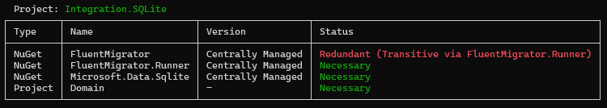

| Package | NuGet |
| :--- | :--- |
| Microsoft.Build | [](https://www.nuget.org/packages/Microsoft.Build/) |
| Microsoft.Build.Locator | [](https://www.nuget.org/packages/Microsoft.Build.Locator/) |
| Spectre.Console | [](https://www.nuget.org/packages/Spectre.Console/) |
| Spectre.Console.Cli | [](https://www.nuget.org/packages/Spectre.Console.Cli/) |

# DepSniff 🕵️‍♂️

**Note: This project is entirely generated by JetBrains Junie.**

**DepSniff** is a lightweight .NET CLI tool designed to help you clean up your C# projects by identifying redundant NuGet packages and project references. It "sniffs out" dependencies that are already provided transitively by other references or appear to be unused in your source code.

## Features

- 📂 **Supports Modern Solutions**: Works with both `.csproj` and the new Visual Studio solution format `.slnx`.
- 🔗 **Redundancy Detection**: Identifies NuGet packages and project references that are explicitly added but already inherited transitively.
- 🔍 **Usage Analysis**: Scans source code to determine if a dependency is actually being used (via namespace analysis).
- 📊 **Clear Reporting**: Generates easy-to-read tables using [Spectre.Console](https://spectreconsole.net/) to show the status of each dependency.
- 🚀 **Fast & Lightweight**: Built on .NET 10.0 for optimal performance.

## Prerequisites

- [.NET 10.0 SDK](https://dotnet.microsoft.com/download/dotnet/10.0) or newer.

## Installation

Currently, DepSniff can be run directly from the source or built as a tool.

```powershell
# Clone the repository
git clone https://github.com/Iceeman76/DepSniff.git
cd DepSniff

# Build the project
dotnet build
```

## Usage

Run DepSniff by pointing it to a solution or project file:

```powershell
dotnet run --project DepSniff -- <PATH_TO_PROJECT_OR_SOLUTION>
```

If you run it without arguments, it searches for a single `.slnx` or `.csproj` file in the current directory:

```powershell
dotnet run --project DepSniff
```

### Example Output



### Understanding the Results

DepSniff categorizes dependencies into three states:
- ✅ **Necessary**: The dependency is used in code and not provided transitively.
- ⚠️ **Uncertain (Not found in code)**: The dependency is explicitly referenced, but no usage was found in the source code (might be used via reflection or dynamic loading).
- ❌ **Redundant (Transitive via ...)**: The dependency is already included by another reference and can likely be safely removed from the project file.
